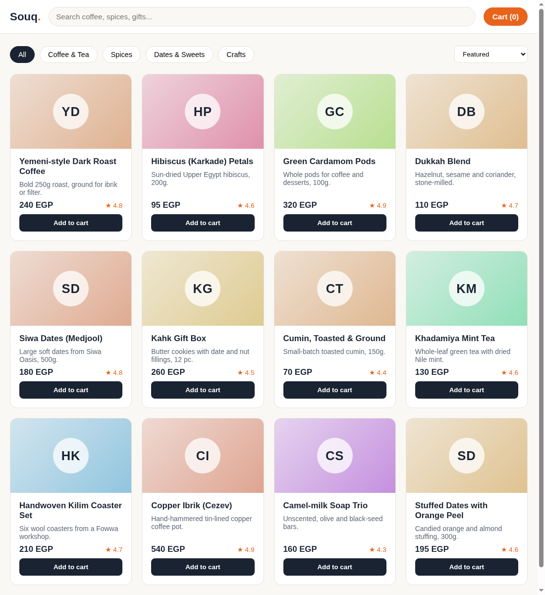

# Souq - React Storefront

A responsive e-commerce front-end built with React 18 + Vite: product catalog with live search, category filters and sorting, a slide-in cart with quantity controls and shipping rules, and a validated checkout form with order confirmation.

The demo catalog is Egyptian-themed (coffee, karkade, dukkah, Siwa dates, crafts) and fully self-contained - gradient monogram tiles instead of image assets, so the demo builds and runs offline.

**[Live demo](https://amr3492.github.io/storefront-react/)** - full catalog, cart and checkout flow, no backend needed.



## Features

- **Catalog**: 12 products across 4 categories, with blurbs, ratings and EGP pricing.
- **Live search + filters + sorting** (featured, price asc/desc, top rated), all client-side via `useMemo`.
- **Cart**: add/merge lines, quantity steppers, remove, subtotal, shipping rule (60 EGP, free over 1,500 EGP), and a "how much more for free shipping" nudge.
- **Checkout**: validated form (name, email, phone, address, city) with inline errors and an order-confirmation state. Demo only - no payment is processed.
- **Testable core**: all cart math is pure functions in `src/lib/cart.js`, covered by 7 vitest tests.

## Run it

```bash
npm install
npm run dev       # dev server
npm test          # cart logic tests
npm run build     # production build to dist/
npm run preview   # serve the production build
```

## Structure

```
src/
├── lib/cart.js          # pure cart logic (add, qty, totals, shipping) + tests
├── data/products.js     # demo catalog
├── components/
│   ├── Header.jsx       # logo, search, cart button
│   ├── Filters.jsx      # category chips + sort
│   ├── ProductCard.jsx  # product tile with monogram art
│   ├── CartDrawer.jsx   # slide-in cart with totals
│   └── Checkout.jsx     # validated form + confirmation
└── App.jsx              # state and composition
```

## Design notes

- No router, no state library: one screen, drawer-based cart/checkout, plain `useState`. The point is a clean, readable front end a client can review in five minutes.
- All money math goes through the tested helpers, never inline arithmetic in components.

## License

MIT - see [LICENSE](LICENSE).
